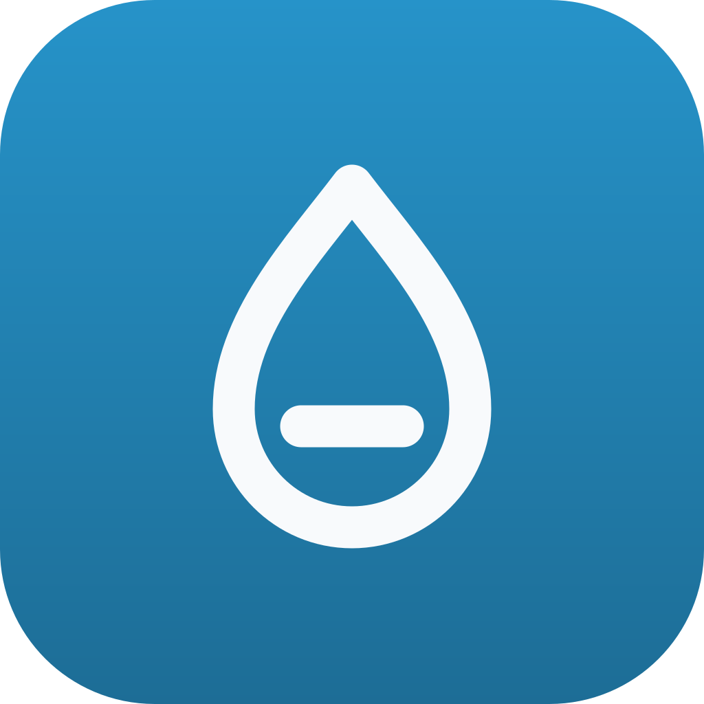
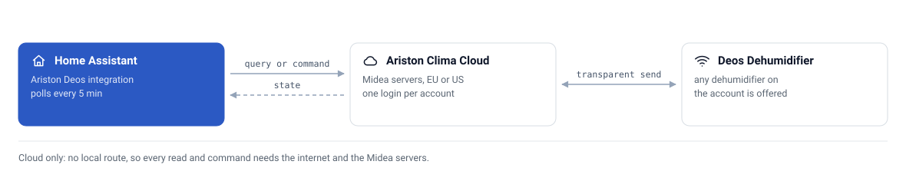
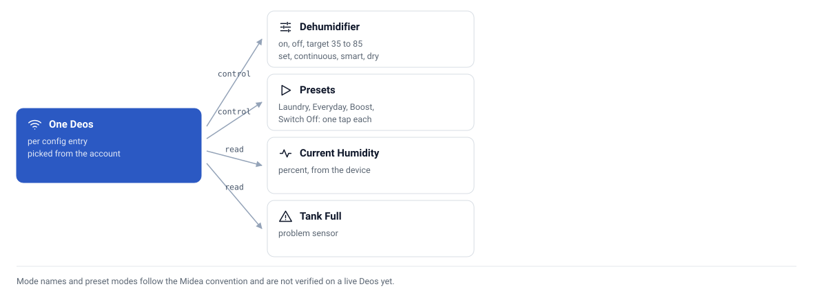

<div align="center">



# 💧 Ariston Deos

**Ariston Deos dehumidifiers in Home Assistant, through the Ariston Clima cloud**


[](https://hacs.xyz)


</div>

---

> **Untested against the live cloud.** Nothing here has yet talked to a real Ariston Clima
> account or a real Deos. Run the [probe](#-usage) first: it tells you whether this is worth
> installing.

## 💡 Why it exists

The Ariston Deos dehumidifiers are controlled from the Ariston Clima phone app. Home
Assistant could not use them: its built-in Midea integration signs in to the
Ariston Clima account fine, then fails at the token and key call (`/v1/iot/secure/getToken`
on `mapp.appsmb.com`, the US server) with code 9999 "system error", so local control is
impossible. Without it a dehumidifier cannot follow the house: run when the air is damp, tell
someone when the tank is full, or sit in an automation with everything else.

This integration fixes that by going through the cloud instead, using the
[`midea-beautiful-air`](https://pypi.org/project/midea-beautiful-air/) library (pinned in
`manifest.json`). It was written for the Deos range, not for one model: it offers every
dehumidifier (appliance type `0xA1`) the Ariston Clima account lists, and the entities are
the same for each. The owner's unit is a Deos 16S NET, the only model it has been aimed at,
so every other Deos stays unconfirmed until someone runs the probe against one.

First hypothesis to test: the cloud region. The library lists a US server and an EU server
for Ariston Clima, and the house is in Scotland.

---

## ✨ Features

| | Feature | What it does |
|---|---|---|
| 🌫️ | Dehumidifier entity | On and off, a target humidity from 35 to 85 percent in steps of 5, and four modes (set, continuous, smart, dry) |
| 🧺 | One-button presets | **Laundry** (clothes drying, fan at maximum), **Everyday** (Auto, 45 to 55 percent by the room temperature), **Boost** (continuous, full power until the tank is full) and **Switch Off**. Each switches the unit on and sets its mode in one command, so anyone in the house can use it |
| 💦 | Current humidity | A sensor with the humidity the device reads, in percent |
| 🚰 | Tank full | A problem sensor that turns on when the tank is full |
| 🔑 | Config flow | Pick EU or US, sign in with the Ariston Clima login, choose the dehumidifier. Handles a changed password through reauthentication |
| ⏱️ | Polling | Cloud polling every 300 seconds by default, 60 to 900 in the options |
| 🩺 | Probe script | Logs in on the EU then the US server, lists appliances, asks for the local token and key, sends one status query, and prints a verdict. Read-only |

The presets follow the Deos 16S NET manual's four modes (Standard, Continuous, Auto, Laundry).
Which mode number the cloud uses for each is the Midea convention and is not verified on a live
device: the probe has to confirm it before the buttons are trusted.

---

## 🗺️ Architecture

<picture>
  <source media="(prefers-color-scheme: dark)" srcset="docs/assets/architecture-dark.svg">
  
</picture>

Every read and command goes from Home Assistant to the Midea cloud and back to the device.
Details, and what comes from the library's source, are in [docs/how-it-works.md](docs/how-it-works.md). Limits:

- It needs the internet and the Midea servers up.
- It polls, so changes appear on the next poll (default 300 seconds, range 60 to 900).
- The API is unofficial: if Midea changes it, this breaks until the library catches up.

What a config entry gives Home Assistant:

<picture>
  <source media="(prefers-color-scheme: dark)" srcset="docs/assets/entities-dark.svg">
  
</picture>

There are no screenshots of Home Assistant yet: they will be added from a real device once
the probe has passed.

---

## 🚀 Quick Start

You need Home Assistant 2026.9 or newer and your Ariston Clima app login.

1. **Run the probe** (below). It costs nothing and changes nothing.
2. **Install manually:** copy `custom_components/ariston_deos/` into `config/custom_components/` and restart Home Assistant.
3. **Add it:** **Settings, Devices and services, Add integration, Ariston Deos.**

The repository is private and HACS cannot install from a private repository, so manual copy is the only route until it is public.

---

## 📖 Usage

### The probe

```bash
pip install midea-beautiful-air        # the probe's only dependency
export ARISTON_EMAIL=you@example.com   # or leave unset: the prompt is hidden
export ARISTON_PASSWORD=...            # or leave unset: the prompt is hidden
python3 scripts/probe.py               # add --region EU or --region US for one server
python3 scripts/probe.py --save-keys ./deos.keys   # also keep the token and key
```

The login never goes on the command line, on screen or onto disk:

- Unset variables are asked for at hidden prompts (email and password).
- Errors print only the exception class and a numeric code.
- `--save-keys` writes a new mode 600 file, refuses symlinks, and refuses an existing file unless you add `--force`.
- It never sends a set command.

It runs these steps for the EU server, then the US server, one line each with PASS or FAIL and the reason:

| Step | What it does |
|---|---|
| Login | `connect_to_cloud` with the "Ariston Clima EU" or "Ariston Clima" app profile |
| Appliances | Lists type, name and the id masked to its last 4 characters; marks dehumidifiers (type `0xA1`) |
| Local token | Asks for the token and key the way the library does (udp id from the appliance id, little-endian then big-endian). Reports only whether they came back and their lengths. With `--save-keys PATH` writes them to PATH with mode 600 and prints the path |
| Cloud status | One status query through `appliance_transparent_send`; prints power, mode (raw number), humidity, target and tank |

### Reading the verdict

| Verdict line | What to do |
|---|---|
| Login works on EU (or US) | That region is the one to use |
| Local token route WORKS | Use HA Core Midea with manual token and key from the `--save-keys` file; delete the file after |
| Local token route FAILS | Local control is out; use this integration's cloud path |
| Cloud status WORKS | The cloud path can read the device; install the integration |
| No region accepted the login | Check the email and password in the Ariston Clima app |

The probe exits 0 if the token or the status worked, 1 if neither did, 2 if the library is missing.

---

## 📁 Repo structure

```text
Ariston-Deos-Home-Assistant/
├── custom_components/
│   └── ariston_deos/       # 🧩 the integration
├── tests/                  # 🧪 integration tests
├── scripts/
│   ├── probe.py            # 🩺 read-only cloud diagnostic
│   └── test_probe.py       # 🧪 unit tests of the probe's pure parts
├── tools/
│   └── gen_diagram.py      # 🔧 draws the two diagrams in docs/assets
├── docs/
│   ├── how-it-works.md     # 📚 routes, region hypothesis, limits
│   └── assets/             # 🖼️ diagrams, brand icon, social preview
├── .env.example            # ⚙️ the probe's two optional variables
├── hacs.json  pyproject.toml  .gitignore
└── AGENTS.md  CHANGELOG.md  LICENSE  README.md  SECURITY.md
```

---

## 🧪 Testing

```bash
python3 -m unittest scripts/test_probe.py              # the probe's pure parts
python3 -m unittest discover -s tests -t .             # the integration (some tests skip without Home Assistant)
python3 tools/gen_diagram.py --check                   # fails if a diagram is stale
```

The probe tests cover id masking, appliance-type matching, udp id derivation, error text, verdict logic and the key file's mode. The integration tests cover the API wrapper, the presets and the coordinator.

---

## 🔒 Security

The login stays in the Home Assistant config entry and goes only to the Midea cloud
servers. See [SECURITY.md](SECURITY.md).

---

## 📄 License

MIT, see [LICENSE](LICENSE). Not affiliated with Ariston or Midea; their names are used only to say what this works with.

---

<p align="center"><sub>Made with ❤️ by <a href="https://github.com/CaputoDavide93">Davide Caputo</a></sub></p>
